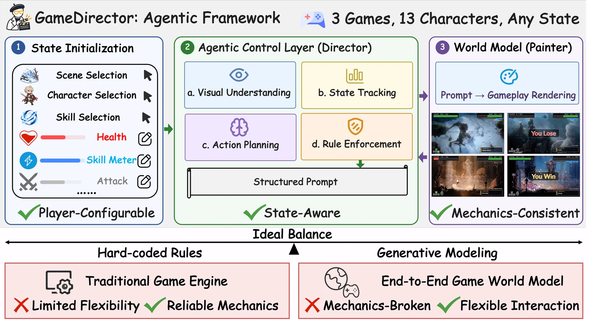
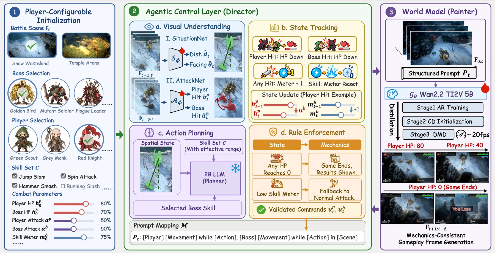

# GameDirector: Decoupling Gameplay Logic from Rendering for Player-Configurable Game World Models

<p>
<a href="https://jimntu.github.io/gamedirector/"></a>
<a href="https://arxiv.org/abs/2609.25652"></a>
<a href="https://github.com/Jimntu/GameDirector_code"></a>
<a href="https://huggingface.co/onepiece1999/GameDirector"></a>
<a href="https://huggingface.co/datasets/onepiece1999/GameDirector-Training-Data"></a>
</p>

> ## **GameDirector: Decoupling Gameplay Logic from Rendering for Player-Configurable Game World Models**
>
> [Zijun Lin](https://jimntu.github.io/)<sup>1,2,4,\*</sup>,
> [Zhiyang Deng](https://teawhite.cn/)<sup>1,3,\*</sup>,
> Yuzhe Wu<sup>1,3</sup>,
> [Bihan Wen](https://personal.ntu.edu.sg/bihan.wen/)<sup>2</sup>,
> [Yeying Jin](https://jinyeying.github.io/)<sup>1,3</sup>
>
> <sup>1</sup>Tencent,
> <sup>2</sup>Nanyang Technological University,
> <sup>3</sup>National University of Singapore,
> <sup>4</sup>Centre for Frontier AI Research, A\*STAR
>
> <sup>\*</sup>Equal contribution

## Introduction

GameDirector: configure the game, direct the action, generate the world!
End-to-end game world models render realistic gameplay but cannot reliably
enforce game mechanics such as health deduction, skill cooldowns, and
termination. GameDirector is an agentic framework that **decouples rule-based
gameplay logic from visual rendering**. Given a player-defined configuration,
the director interprets the generated frames, updates explicit game states,
plans boss actions, and enforces the rules. It then turns these decisions into
text prompts that drive a video world model.



- **3 games, 13 characters:** No Rest for the Wicked (NRFTW), Vampire, and
  Hollow Knight (HK), with 5 players and 8 bosses.
- **Any initial state:** players set HP, attack strength, and skill meters.
- **Mechanics fidelity of 99.6%**, compared with 21–34% for end-to-end
  baselines.
- **Decision quality improves by 39.9%** over the best end-to-end baseline.

## Installation

Requirements: Python 3.10+, an NVIDIA GPU with CUDA and bfloat16 support, and
FFmpeg (`ffmpeg` and `ffprobe` on `PATH`).

```bash
git clone https://github.com/Jimntu/GameDirector_code.git
cd GameDirector_code

# Main environment: world model, AttackNet, SituationNet, closed loop
python3 -m venv code/.venv
code/.venv/bin/pip install -U pip huggingface_hub
code/.venv/bin/pip install -r code/requirements.txt

# Separate environment for the local Gemma planner service
python3 -m venv code/.venv-gemma
code/.venv-gemma/bin/pip install -r code/llm/requirements.txt
```

`code/run.sh` uses `code/.venv` automatically. The Gemma service uses
`code/.venv-gemma`.

### Model downloads

| Resource | Required for | Files | Download |
|---|---|---|---|
| GameDirector checkpoints | Inference | `attacknet/attacknet.pt`, `situationnet/situationnet.pt`, `world_model/ar_world_model.safetensors` | [Hugging Face](https://huggingface.co/onepiece1999/GameDirector/tree/main) |
| Wan2.2 VAE and T5 | Inference and training | `Wan2.2_VAE.pth`, `models_t5_umt5-xxl-enc-bf16.pth` | [Hugging Face](https://huggingface.co/Wan-AI/Wan2.2-TI2V-5B/tree/main) |
| UMT5 tokenizer | Inference and training | `google/umt5-xxl/` | [Hugging Face](https://huggingface.co/Wan-AI/Wan2.1-T2V-1.3B/tree/main/google/umt5-xxl) |
| Gemma 4 E2B (planner) | Inference | full repository | [Hugging Face](https://huggingface.co/google/gemma-4-E2B-it) |
| Wan2.2 DiT base weights | World-model training only | three `diffusion_pytorch_model-*.safetensors` shards | [Hugging Face](https://huggingface.co/Wan-AI/Wan2.2-TI2V-5B/tree/main) |

Expected inference layout:

```text
GameDirector_code/
├── model/
│   ├── attacknet/attacknet.pt
│   ├── situationnet/situationnet.pt
│   ├── world_model/ar_world_model.safetensors
│   ├── SHA256SUMS
│   └── Wan-AI/
│       ├── Wan2.2-TI2V-5B/
│       │   ├── Wan2.2_VAE.pth
│       │   └── models_t5_umt5-xxl-enc-bf16.pth
│       └── Wan2.1-T2V-1.3B/google/umt5-xxl/
│           └── ... tokenizer files ...
└── external_models/gemma-4-E2B-it/
    └── ... Gemma files ...
```

Download everything into this layout from the repository root:

```bash
# GameDirector checkpoints (the repo's own model/README.md is kept)
hf download onepiece1999/GameDirector \
  --include "attacknet/*" --include "situationnet/*" --include "world_model/*" \
  --local-dir model
(cd model && sha256sum -c SHA256SUMS)

# Wan VAE, text encoder, and tokenizer
hf download Wan-AI/Wan2.2-TI2V-5B \
  --include Wan2.2_VAE.pth --include models_t5_umt5-xxl-enc-bf16.pth \
  --local-dir model/Wan-AI/Wan2.2-TI2V-5B
hf download Wan-AI/Wan2.1-T2V-1.3B --include "google/umt5-xxl/*" \
  --local-dir model/Wan-AI/Wan2.1-T2V-1.3B

# Gemma planner: accept its license on Hugging Face first
hf auth login
hf download google/gemma-4-E2B-it --local-dir external_models/gemma-4-E2B-it
```

`model/**` and `external_models/` are ignored by git. To keep weights
elsewhere, point the environment variables at your own paths:

```bash
export GAMEDIRECTOR_ATTACK_CHECKPOINT=/abs/path/attacknet/attacknet.pt
export GAMEDIRECTOR_SITUATION_CHECKPOINT=/abs/path/situationnet/situationnet.pt
export GAMEDIRECTOR_WORLD_MODEL_CHECKPOINT=/abs/path/world_model/ar_world_model.safetensors
export GAMEDIRECTOR_BASE_MODEL=/abs/path/to/wan-assets   # must directly contain Wan-AI/
export GAMEDIRECTOR_LLM_MODEL=/abs/path/to/gemma-4-E2B-it
```

All variables are listed in `code/config.example.env`. Step-by-step download
notes are in [`model/README.md`](model/README.md).

## Code architecture



GameDirector has three parts that run in a closed loop:

1. **Configure.** The player selects the scene, characters, and skills, and
   sets HP, attack strength, and skill meters.
2. **Direct.** The agentic control layer reads the latest frames.
   AttackNet detects player and boss hits, and SituationNet estimates distance
   and facing. Explicit combat states are updated, a local 2B Gemma planner
   chooses the boss skill, and rule enforcement validates the command.
3. **Generate.** The validated commands become a structured prompt. A causal
   autoregressive (AR) world model built on Wan2.2-TI2V-5B renders the next
   0.25-second cell, and the new frames are fed back to the director.

```text
GameDirector_code/
├── code/
│   ├── run.sh                      # single entry point: train / infer / validate / verify-rollouts
│   ├── config.example.env          # all GAMEDIRECTOR_* environment variables
│   ├── requirements.txt
│   ├── validate_bundle.py          # checks installed checkpoints
│   ├── verify_rollouts.py          # checks state transitions, decisions, and video frames
│   ├── agentic_control/            # the director
│   │   ├── run_closed_loop.py      # closed-loop inference CLI (`run.sh infer`)
│   │   ├── train_attacknet.py      # `run.sh train attacknet`
│   │   ├── train_situationnet.py   # `run.sh train situationnet`
│   │   ├── attacknet/              # hit-detection model, data, losses, metrics
│   │   ├── situationnet/           # distance/orientation model, data, losses
│   │   └── closed_loop/
│   │       ├── loop.py             # per-cell director loop
│   │       ├── combat.py           # HP, damage, and termination rules
│   │       ├── skills.py           # skill meter, costs, and cooldowns
│   │       ├── decision.py         # Gemma planner and rule enforcement
│   │       ├── prompts.py          # player tracks, vocabulary, prompt mapping
│   │       ├── games.py            # per-game characters and skills
│   │       ├── components.py       # AttackNet / SituationNet / world-model runners
│   │       └── hud_renderer.py     # HP and skill-meter overlay
│   ├── distill/                    # causal AR world-model inference
│   │   ├── inference/ar_pipeline.py
│   │   └── worldmodel_cf/          # causal DiT, flow matching, checkpoint loading
│   ├── world_model/                # world-model training and shared Wan components
│   │   ├── scripts/train.sh        # `run.sh train world_model`
│   │   ├── training/               # training loop and per-game data loading
│   │   ├── world_model/            # DiT, VAE, and text-encoder wrappers
│   │   └── diffsynth/              # minimal Wan/DiffSynth dependencies
│   └── llm/                        # local OpenAI-compatible Gemma service
├── example/
│   ├── run_rollout.sh              # one-click rollouts for the bundled inputs
│   ├── manifest.json
│   ├── nrftw/nrftw_01..03/         # first_frame.png, player_track.json, vocabulary.json
│   └── hk/hk_01..05/
├── model/                          # local checkpoint mount point (weights downloaded separately)
├── output/ar_agentic/              # reference rollouts
└── assets/                         # README figures
```

## Run examples

Generate all eight bundled rollouts:

```bash
export GAMEDIRECTOR_LLM_MODEL="$PWD/external_models/gemma-4-E2B-it"
./example/run_rollout.sh all
```

Generate one game only:

```bash
./example/run_rollout.sh nrftw     # nrftw_01..03
./example/run_rollout.sh hk        # hk_01..05
```

The Gemma service starts automatically on `127.0.0.1:8018`. Set
`EXAMPLE_TICKS` to shorten runs for a quick test, or `EXAMPLE_OUTPUT_ROOT` to
write elsewhere.

Each rollout writes `output/ar_agentic/<game>/<sample>/`:

| File | Content |
|---|---|
| `initial.json` | initial combat state, perception, and runtime settings |
| `tick_XXXX.json` | per-cell prompts, AttackNet signals, state transitions, planner decisions |
| `clip_XXXX.mp4` | HUD video for each 5-second tick |
| `summary.json` | outcome and final state |
| `rollout.mp4` | full combined video |

Check a finished run:

```bash
./code/run.sh validate                            # installed checkpoints
./code/run.sh verify-rollouts                     # all eight rollouts
./code/run.sh verify-rollouts --sample nrftw_01   # one rollout
```

Reference results in `output/ar_agentic/`:

| Sample | Matchup | Outcome | Length |
|---|---|---|---|
| nrftw_01 | Red Knight vs Plague Leader | You Win | 43.5 s |
| nrftw_02 | Green Scout vs Mutant Soldier | You Win | 23.5 s |
| nrftw_03 | Grey Monk vs Golden Bird (120/120 attack, 6 ticks) | You Lose | 12.5 s |
| hk_01 | the Knight vs Broken Vessel | You Win | 14.75 s |
| hk_02 | the Knight vs Hornet | You Win | 14.5 s |
| hk_03 | the Knight vs Dung Defender | You Win | 12.75 s |
| hk_04 | the Knight vs Hornet | You Win | 16.5 s |
| hk_05 | the Knight vs Gruz Mother | You Win | 13.5 s |

See [`example/README.md`](example/README.md) for the input format, default
combat state, and termination rules.

## Inference

Run the closed loop on your own initial frame and player track:

```bash
./code/run.sh infer \
  --game nrftw \
  --image /path/to/first_frame.png \
  --player-prompts /path/to/player_track.json \
  --prompt-root /path/to/nrftw_5s_prompts/prompts \
  --player-hp 800 --boss-hp 1600 \
  --player-attack 55 --boss-attack 35 \
  --boss-skill 30 --boss-skill-max 30 \
  --ticks 12
```

The prompt vocabulary can be a compact snapshot (`--vocabulary-file`, as in
`example/`) or a raw prompt corpus (`--prompt-root`). The HP, attack, and
skill arguments set the real combat state. They drive damage, skill readiness
and cost, the state sent to Gemma, the event logs, and the HUD.

The bundled examples use stage-1 causal AR generation with 30 Euler steps,
CFG 2.0, and one continuous KV-cache session with a 3+17 attention sink. To use
an already-running Gemma service, pass `--no-llm-auto-start --llm-base-url URL`.
Inspect all options, including character choices and cooldown overrides, with:

```bash
./code/run.sh infer --help
```

## Training

Download the [GameDirector training data](https://huggingface.co/datasets/onepiece1999/GameDirector-Training-Data)
(about 61 GB). It contains 23,966 NRFTW samples and 10,324 HK samples as
WebDataset tar shards with per-game `train.jsonl` indexes. Evaluation examples
are excluded. The Vampire split used by the three-game checkpoints is not
included.

```bash
hf download onepiece1999/GameDirector-Training-Data \
  --repo-type dataset \
  --local-dir /path/to/GameDirector-Training-Data
```

The training commands take local data roots and train/validation manifests.
Unpack the shards into the local clip/state layout first.

Train AttackNet and SituationNet with parallel lists of games, data roots, and
manifests. The game keys are `nrftw`, `vampire`, and `hk`:

```bash
./code/run.sh train attacknet \
  --game_names nrftw vampire hk \
  --data_root /data/nrftw /data/vampire /data/hk \
  --train_jobs /data/splits/n_train.json /data/splits/v_train.json /data/splits/h_train.json \
  --val_jobs /data/splits/n_val.json /data/splits/v_val.json /data/splits/h_val.json

./code/run.sh train situationnet \
  --game_names nrftw vampire hk \
  --data_root /data/nrftw /data/vampire /data/hk \
  --train_jobs /data/splits/n_train.json /data/splits/v_train.json /data/splits/h_train.json \
  --val_jobs /data/splits/n_val.json /data/splits/v_val.json /data/splits/h_val.json
```

Train the world model. This also needs the Wan2.2 DiT base weights from the
model table:

```bash
export GAMEDIRECTOR_BASE_MODEL="$PWD/model"
export WORLD_MODEL_DATA_ROOT=/data/world_model
export WORLD_MODEL_METADATA=/data/world_model/jobs_train.jsonl
export CUDA_VISIBLE_DEVICES=0,1,2,3

./code/run.sh train world_model
```

The script derives the process count from `CUDA_VISIBLE_DEVICES` and writes
checkpoints to `output/world_model/`. It trains at 480×832 with learning rate
`5e-5` and saves every 500 steps. Run `./code/world_model/scripts/train.sh
--help` for all options, and see `code/world_model/TRAINING.md` for details.

## Citation

If you find our work useful in your research, please cite it as follows:

```bibtex
@article{lin2026gamedirector,
  title={GameDirector: Decoupling Gameplay Logic from Rendering for Player-Configurable Game World Models},
  author={Lin, Zijun and Deng, Zhiyang and Wu, Yuzhe and Wen, Bihan and Jin, Yeying},
  journal={arXiv preprint arXiv:2609.25652},
  year={2026}
}
```
